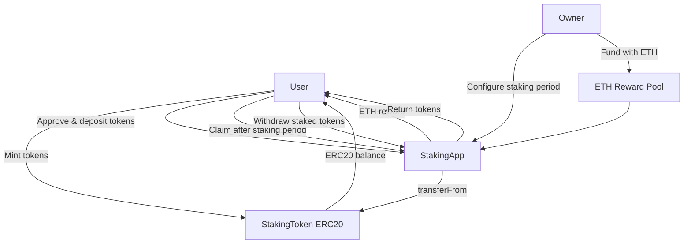
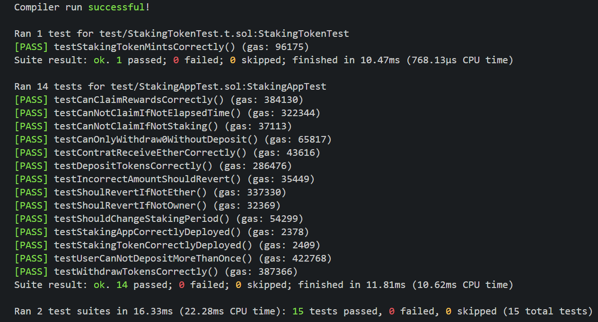
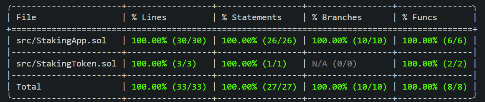

# StakingApp

A Solidity staking application that allows users to lock a fixed amount of ERC20 tokens and claim periodic rewards in ETH.

Built with **Solidity 0.8.24**, **Foundry**, and **OpenZeppelin Contracts** as an educational project for a blockchain development master's program.

The implementation focuses on ERC20 interactions, staking mechanics, access control, ETH transfers, and automated smart contract testing.

## How It Works

The system consists of two smart contracts:

- **[StakingToken.sol](./src/StakingToken.sol)**: ERC20 token used for staking. Includes a public mint function for educational purposes.
- **[StakingApp.sol](./src/StakingApp.sol)**: Manages token deposits, withdrawals, staking periods, and ETH rewards.

Users stake a predefined token amount and become eligible to claim ETH rewards after each staking period.

The contract owner configures the staking period and funds the reward pool.

### System Flow



### Staking Lifecycle

1. **Mint:** The user obtains STK tokens through `mint()`.
2. **Approve:** The user authorizes StakingApp to transfer the required tokens.
3. **Deposit:** The user stakes the exact `fixedStakingAmount`.
4. **Wait:** The configured `stakingPeriod` must elapse.
5. **Claim:** The user receives `rewardPerPeriod` in ETH.
6. **Repeat or withdraw:** Claiming resets the reward timer. Users can withdraw their staked tokens at any time.

## Technical Overview

### StakingApp

| Function                       | Description                                    | Access |
| ------------------------------ | ---------------------------------------------- | ------ |
| `depositTokens(uint256)`       | Deposits the exact required ERC20 amount       | Public |
| `withdrawStakingToken()`       | Withdraws the user's staked tokens             | Public |
| `claimRewards()`               | Transfers ETH rewards after the staking period | Public |
| `changeStakingPeriod(uint256)` | Updates the staking period                     | Owner  |
| `receive()`                    | Accepts ETH to fund staking rewards            | Owner  |

**Key parameters**

| Parameter            | Description                                              |
| -------------------- | -------------------------------------------------------- |
| `stakingToken`       | ERC20 token contract address                             |
| `stakingPeriod`      | Minimum time between reward claims, in seconds           |
| `fixedStakingAmount` | Exact number of token units required per deposit         |
| `rewardPerPeriod`    | ETH reward distributed per eligible claim, in wei        |
| `userBalance`        | Staked balance associated with each user                 |
| `elapsePeriod`       | Timestamp of the user's last deposit or successful claim |

The contract follows the **Checks-Effects-Interactions (CEI)** pattern in its withdrawal and reward-claiming functions.

### StakingToken

Implements OpenZeppelin's ERC20 standard with a public `mint(uint256)` function.

Token name and symbol are defined during deployment.

## Getting Started

### Requirements

- [Foundry](https://getfoundry.sh/)
- [Solidity 0.8.24](https://docs.soliditylang.org/en/v0.8.24/)
- [OpenZeppelin Contracts](https://docs.openzeppelin.com/contracts/)

### Installation

Clone the repository and initialize its dependencies:

```bash
git clone --recurse-submodules <REPOSITORY_URL>
cd stakingApp-foundry
```

If the repository is already cloned:

```bash
git submodule update --init --recursive
```

### Build

```bash
forge build
```

### Run Tests

```bash
forge test
```

For detailed execution traces:

```bash
forge test -vvvv
```

### Test Coverage

```bash
forge coverage
```

## Testing

Tests are implemented using Foundry's Forge framework.

- **[StakingAppTest.sol](./test/StakingAppTest.sol)**: Covers deposits, withdrawals, reward claims, ownership restrictions, and revert conditions.
- **[StakingTokenTest.t.sol](./test/StakingTokenTest.t.sol)**: Validates ERC20 token minting.

### Test Results

**15 tests passed · 0 failed · 0 skipped**



### Coverage Results

| Metric     | Coverage     |
| ---------- | ------------ |
| Lines      | 100% (33/33) |
| Statements | 100% (27/27) |
| Branches   | 100% (10/10) |
| Functions  | 100% (8/8)   |



Results obtained using `forge test` and `forge coverage`.

## Project Structure

```text
stakingApp-foundry/
├── src/
│   ├── StakingApp.sol
│   └── StakingToken.sol
├── test/
│   ├── StakingAppTest.sol
│   └── StakingTokenTest.t.sol
├── script/
├── lib/
├── assets/
│   └── images/
│       ├── forge_test_result.png
│       └── forge_coverage_result.png
├── foundry.toml
└── README.md
```

## Security Considerations

This project is intended for **educational purposes only** and has not been audited.

Known limitations and design decisions:

- **Public minting:** Any address can mint STK tokens without restrictions.
- **Fixed deposits:** Users can maintain only one active staking position.
- **Reward funding:** ETH rewards depend on the balance provided by the owner.
- **Owner privileges:** The owner can modify the staking period at any time.
- **ERC20 transfers:** Token transfer return values are not explicitly checked.
- **Withdrawals:** Tokens can be withdrawn immediately, without a lock-up period.

The implementation demonstrates core staking concepts rather than production-ready staking economics or security guarantees.

## License

This project is licensed under the [MIT License](./LICENSE).
